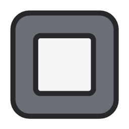

<div align="center">



# FolderFrame

Carpetas para el escritorio de Windows: un icono que se abre en una tarjeta con tus apps.

Por [yarzalv](https://github.com/yarzalv)

**[⬇ Descargar FolderFrame.exe](https://github.com/yarzalv/FolderFrame/releases/latest/download/FolderFrame.exe)** · [Todas las versiones](https://github.com/yarzalv/FolderFrame/releases)

</div>

## Qué hace

Cada carpeta de tu disco que añadas aparece en el escritorio como un icono con una vista previa de su contenido. Al abrirlo se despliega una tarjeta con sus apps y accesos directos, lista para lanzar cualquiera con doble clic.

- **Tres formas de abrir cada carpeta:** al pasar el cursor, con un clic o con doble clic.
- **Búsqueda** dentro de la carpeta (la lupa de la tarjeta; `Enter` abre la primera coincidencia).
- **Arrastrar y soltar:** suelta accesos directos sobre una carpeta para guardarlos dentro; si sueltas un archivo o un programa, la carpeta recibe un acceso directo y el original no se mueve.
- **Posición recordada:** cada icono vuelve exactamente a su sitio al reiniciar, también con varios monitores y escalados distintos.
- **Por carpeta:** nombre, tamaño de la tarjeta y de los iconos, orden, archivos ocultos, extensiones, flecha de acceso directo y bloqueo de posición.
- **Menú contextual** de Windows en cada app y un menú propio en cada carpeta (clic derecho).
- **Inicio con Windows** mediante una tarea programada, para abrirse nada más iniciar sesión.
- Doble clic en el escritorio para ocultar o mostrar todas las carpetas (opcional).

Las carpetas siempre quedan por debajo de tus ventanas, como los iconos normales del escritorio.

## Uso

1. [Descarga la última versión](https://github.com/yarzalv/FolderFrame/releases/latest/download/FolderFrame.exe) y ejecuta `FolderFrame.exe` (no necesita instalación ni .NET). Aparece un icono en la bandeja del sistema.
2. Clic derecho en el icono de la bandeja → **Añadir carpeta…** y elige una carpeta.
3. Mueve la carpeta con el botón de mover de su tarjeta, o arrastrando el icono si se abre con clic o doble clic.
4. Para cambiar cómo se abre o su aspecto: engranaje de la tarjeta, o clic derecho sobre la carpeta → **Configuración…**

La configuración general (lista de carpetas, modo de apertura por defecto, inicio con Windows) está en la bandeja → **Configuración**.

Los ajustes se guardan en `HKCU\SOFTWARE\FolderFrame` y los registros en `%APPDATA%\FolderFrame`.

## Compilar

Requisitos: Windows 10 (2004) o posterior y Visual Studio 2022 con la carga de trabajo de escritorio .NET (el proyecto usa referencias COM, que necesitan el MSBuild de Visual Studio, no `dotnet build`).

Ejecutable único autocontenido (no necesita .NET instalado):

```bash
"C:/Program Files/Microsoft Visual Studio/2022/Community/MSBuild/Current/Bin/MSBuild.exe" FolderFrame/FolderFrame.csproj -t:Publish -restore -p:Configuration=Release -p:Platform=x64 -p:RuntimeIdentifier=win-x64 -p:SelfContained=true -p:PublishSingleFile=true -p:IncludeNativeLibrariesForSelfExtract=true -p:DebugType=none -p:PublishDir=publish/
```

## Autor

[yarzalv](https://github.com/yarzalv)

## Licencia

MIT. Consulta [LICENSE.txt](LICENSE.txt).

## Librerías

- [WPF UI](https://github.com/lepoco/wpfui) – MIT
- [SVG.NET](https://github.com/svg-net/SVG) – MS-PL
- [H.Hooks](https://github.com/HavenDV/H.Hooks) – MIT
- [Windows API Code Pack](https://github.com/contre/Windows-API-Code-Pack-1.1) – licencia propia
